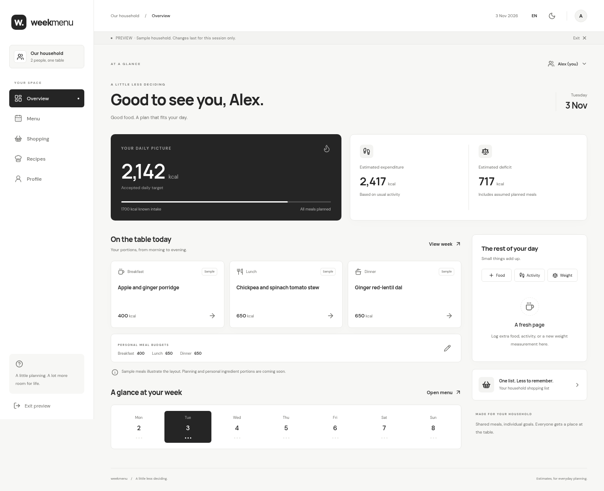
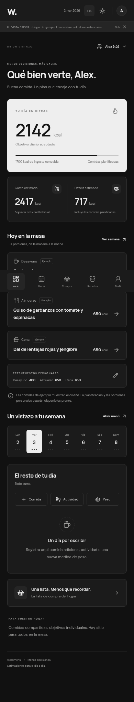

# Milestone 1 review

The first application milestone implements the foundation and personal-calculation flows. This is the agreed review boundary before implementing the planner.

## Available now

- Responsive React/TypeScript shell with the five tabs, member selector, English/Spanish per profile, and monochrome light/dark themes. Fonts are self-hosted.
- Google PKCE sign-in integration with Supabase; configured-owner bootstrap, approved-address invitations, one-owner transfer, removal and leaving. No public household creation.
- Server-controlled personal writes and shared household reads, with direct client writes revoked and read access protected by row-level policies.
- Adult metric questionnaire, dietary pattern and ingredient exclusions. Mifflin–St Jeor estimates, confirmed activity multipliers, calendar-day goal deficits and pre-rounding screening.
- Explicit recalculation/acceptance, including all three manual meal budgets, maintenance review when the goal is reached, and personal date/meal overrides. An old accepted target remains until a new one is accepted.
- Today's extra-food, source-coded activity and weight logs; edit/delete today, retained read-only history. Activities replace only that day's expenditure allowance.
- Independent personal-day and household meal-date cutoff records, server-time IANA calculations, serialized mutations and immutable due snapshots. Timezone changes cannot reopen a closed date.
- An explicitly separate, ephemeral sample household for visual/interaction review, plus a read-only browser for the 48 prepared starter recipes, including prerequisite preparation instructions.

## Visual review

Mobile dashboard · dark mode · Spanish

These show the clearly labelled sample household, not real household records.

## Scope boundaries

The Menu tab has the seven-card week layout. It does not generate, save or resize meals yet. Sample meals exist only in preview memory and are labelled. Production calorie summaries count known food only and label incomplete days; budgets never masquerade as consumed meals.

Recipe/catalogue editing, ingredient conversions in the planner, substitutions, per-person dessert, eating-out replacement and historical meal snapshots belong to milestone 2. The shared shopping checklist, generated quantities, PWA installation and offline reconciliation belong to milestone 3. Deployment/release remains milestone 4. A read-only starter browser does not import household content into Supabase.

The initial activity import covers 24 choices for ages 19–59. Age 18 and 60+ remain explicit gaps; see [source and coverage notes](activity-sources.md). No suitable values are guessed.

## Validation

- Production TypeScript/build checks, including a build with placeholder Supabase configuration to include the authenticated application path.
- Formatting and Git whitespace checks.
- 17 passing formula/PostgreSQL tests and 5 passing Chromium browser flows.
- Formula tests covering the agreed coefficients, screening boundaries, logged-activity replacement, incomplete intake totals, practical rounding and DST/calendar dates.
- Actual PostgreSQL migration/RLS/function tests through PGlite: unauthorized access, direct-write denial, revision checks, server-computed targets/METs, personal-only changes, immutable history, invitations, ownership transfer and removal retention.
- Chromium browser flows for profile → review → acceptance, activity/food/weight entry, maintenance review, member read-only views, owner invitations, recipe prerequisite preparation, all five tabs, mobile widths, Spanish and dark mode.

These local checks do not claim a live Supabase or Google OAuth test. No project credentials or production origin were configured. [Setup instructions](setup.md) describe the remaining hosted verification.

## Review focus

Review the dashboard density on a phone, the three-budget acceptance flow, activity labels and source coverage, and the clarity of household data visibility. After this milestone is accepted, the next work is recipe/catalogue editing and real menu generation with individual portions.
