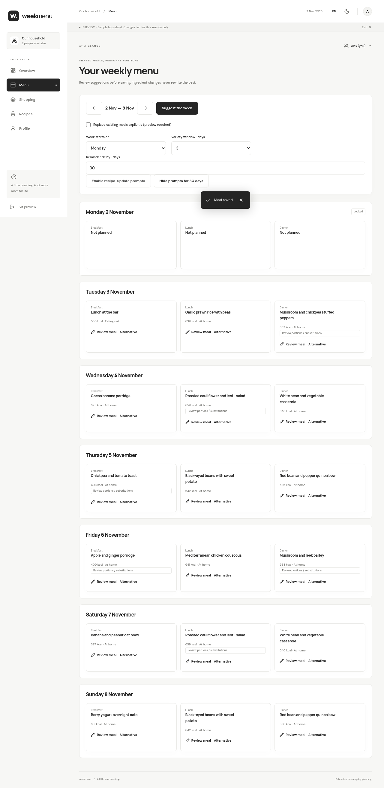

# Milestone 2: household content and meal planning

This milestone adds the editable household catalogue and recipes, saved menus and reviewed personal portions. It is a review boundary; no production migrations or deployment are performed automatically.

## Workflows

- **Recipes** has recipe and ingredient views. Create/edit names in either language, add optional manual translations, nutrition per 100 g, reference state, dietary compatibility, canonical variety keys, and ingredient-specific unit conversions. Archive retains references and blocks new automatic selections. Referenced data is never cascade-deleted.
- Recipes contain ingredient quantities, units, main/base roles, instructions, sides and optional dessert. Starter prerequisite instructions remain visible. New recipes use the entered language; a missing translation falls back to the available name.
- **Menu** shows seven date cards. Suggest a week or one empty meal, then review before applying. Existing meals remain by default; replacing is explicit and previewed. Breakfast recipes are individual; lunch/dinner have one shared base recipe with personal variants.
- Active, onboarded members with accepted budgets can be included. Existing plans are not backfilled when a new member joins. Removal drops only unlocked participants; locked history remains.
- Suggestions respect dietary patterns and ingredient exclusions. The 19 starter substitution links have recipe-specific suitability and preparation overrides; all suggested replacements are shown for review. The engine does not invent a culinary replacement based only on calories. Adding a food does not automatically certify substitution suitability.
- Quantities scale proportionally to each person's budget, using practical rounding and defined unit conversions. Actual saved quantities determine calories. A required amount that rounds to zero leaves a suggestion gap, instead of silently removing an ingredient. Overshoot is a visible warning, with manual quantity adjustment.
- Dessert can be selected separately per person. Eating out requires a description and explicit calorie estimate, replaces only that participant's home-cooked portion and removes their ingredient contribution. Other members retain their portions.
- The main/base ingredient window defaults to three days and is configurable from 1–14. It checks both directions and across week boundaries, includes lunch and dinner on the same date and exempts breakfast. No suitable recipe produces an explicit gap and an invitation to add recipes; rules are not silently relaxed.
- Meal edits affect only that meal. A prompt offers updating a saved recipe from the displayed member's confirmed variant as one reference serving. The prompt can be disabled, re-enabled or postponed by a configurable number of days.

## Authority and history

PostgreSQL validates access, current membership, date cutoffs, content revisions, catalogue conversions, dietary compatibility, canonical variety roles, calorie totals and budgets. Client-supplied calories, nutrition metadata and budget values are not authoritative for home-cooked portions. Eating-out calories are explicitly a manual estimate.

The global revision checked on applying a preview includes changes to profiles, budgets and membership. Recipe and ingredient saves check their own revisions. Stale drafts remain available for review; a fresh preview or explicit reload is required. The whole submitted batch commits atomically, with superseded slots removed from the variety comparison inside that transaction.

Due dates are closed before edits. Catalogue nutrition/conversion changes recalculate unlocked portions at their saved quantities, without resizing or silently substituting ingredients. Dietary conflicts become review flags. Recipe edits affect future selections; existing meal recipe snapshots and quantities stay intact until explicit replacement. Locked meals retain nutrition, quantities, conversions, instructions and membership snapshots, and can be inspected read-only.

The single-household architecture and existing Google/Supabase authentication are retained. Exposed tables have active-member read policies; direct client writes are revoked. Only controlled functions can mutate shared content and meals. Formula/permission checks from milestone 1 remain in the test suite.

## Database rollout

The existing live app uses the foundation migrations. **Apply only these two new migrations, in order, before deploying the new frontend:**

1. `supabase/migrations/202611030003_planning.sql`
2. `supabase/migrations/202611030004_starter_food.sql`

Use the Supabase SQL editor as the project administrator or your linked migration workflow. Do not rerun the foundation migration against an existing database. The starter import adds the 97 ingredients, 48 recipes and 19 substitution rules with provenance; existing IDs are left unchanged. This task does not require changing Google OAuth credentials, callback URLs, or Cloudflare environment variables.

The frontend now loads the authorized household planning library. The household snapshot includes profiles, budgets and planning data atomically. Until the migration is installed, the planner reports that household planning is not ready. Review the PR, apply migrations, then deploy the merged frontend. Preview mode remains explicitly separate and temporary; it does not modify Supabase.

## Verification and remaining delivery

Unit and PostgreSQL integration tests cover proportional quantities, mass/count conversions, personal desserts, curated substitutions, rolling variety, stale saves, server-calculated energy and budgets, frozen history, catalogue recalculation, recipe snapshots, eating out, member removal, prompt preferences and batch replacement. **32 unit/PostgreSQL tests and 8 Chromium flows pass locally.** Production builds and formatting checks pass. Chromium covers menu review/apply, eating-out edits, ingredient conversions and creating a recipe on mobile, alongside the foundation flows.

The shared shopping checklist, reviewable shopping diffs, offline queue and installable PWA are milestone 3. Planning already persists final per-person ingredient quantities and excludes eating-out contributions, ready for that work. Real mobile-device and hosted-project verification remains part of rollout; local PostgreSQL/Chromium checks do not constitute a live Supabase migration or deployment.

## Preview

The screenshot uses the explicitly labelled in-memory sample household.
