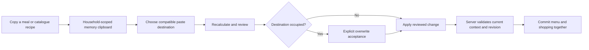

# Version 3 — technical design

Status: proposed design accompanying the [product specification](specification.md). D1–D3 are confirmed. API names below describe intended responsibilities; they are not deployed endpoints or a promised migration numbering scheme.

## 1. Baseline findings from the current code

| Area                 | Existing implementation                                                                                                                                                               | Consequence for version 3                                                                                                                      |
| -------------------- | ------------------------------------------------------------------------------------------------------------------------------------------------------------------------------------- | ---------------------------------------------------------------------------------------------------------------------------------------------- |
| Draft swaps          | `src/domain/menu-draft.ts` accepts one `breakfastMember` and rebuilds that member at both endpoints. `Planner` keeps selection inside preview state.                                  | Saved-menu swaps and two distinct breakfast recipients under D1 need explicit endpoints and matching server validation.                        |
| Meal planning        | `replan` and `makePortion` use destination targets, ingredient resolution and unit-aware rounding. Shared breakfast plans contain multiple personal portions.                         | Reuse the arithmetic; never replace a whole breakfast plan when changing one participant.                                                      |
| Recipe readers       | `RecipeReader` receives a catalogue recipe and reference ingredients. `MealSnapshotView` receives the actual planned portions.                                                        | Allocation needs explicit meal context rather than adding fabricated household shares to the generic catalogue reader.                         |
| Shopping             | `shopping_required` aggregates saved meal lines in an inclusive date range. Migration 8 adds reconciliation on menu writes/reads; migration 12 applies date-range changes atomically. | Add expiration to the authoritative contribution filter and fingerprint, not just DOM filtering.                                               |
| Historical locks     | `guard_meal_day`, `close_due`, shared meal locks and personal-day snapshots intentionally reject closed-day changes.                                                                  | A client-side hidden button cannot implement valid historical correction. Keep ordinary APIs locked and add a narrowly scoped correction path. |
| Activities           | `LogForm` places all source codes in one grouped selector. The local dataset contains 24 coded variants across distinct activity types.                                               | Add a two-stage UI mapping while preserving source codes, METs, age eligibility and server validation.                                         |
| Catalogue            | `Catalogue` filters and renders all `planning.recipes` or `planning.ingredients`; creation actions are in its header. Household snapshots include the full planning library.          | Rendering `.slice(0, 50)` alone would not satisfy loading/payload goals. Separate browsing pages from planning/reference data.                 |
| Content chronology   | Catalogue base tables lack creation columns; `app_private.content_versions` records version creation times.                                                                           | Recover credible private-item ordering from available version history, and define a stable fallback for legacy/starter records.                |
| Budget save feedback | `Workspace.operate` puts mutation and `refresh()` under one catch. The budget form submits changed meals through multiple individual calls.                                           | Reproduce both refresh-after-commit failure and partial batch failure; separate acknowledgement from reloading and use an atomic budget batch. |
| Help and controls    | The dashboard permanently renders `.planning-note`; Menu groups navigation and suggestion actions in one `.button-row`.                                                               | Add an accessible help popover and explicit responsive layout groups without changing week semantics.                                          |

The budget finding is a code-level failure mechanism worth testing, not an assertion about the user's unobserved production response. Capture safe action/error codes and transaction outcomes during reproduction; do not log access tokens, full profiles or household health payloads to diagnose it.

## 2. Shared planning state and endpoint model

Define an endpoint independently of its visual card:

```ts
type MealEndpoint = {
  day: string;
  mealType: "breakfast" | "lunch" | "dinner";
  memberId?: string; // required for a breakfast target
};
```

An endpoint is always interpreted inside the repository's verified household/membership context. It does not authorize access by itself. For a shared target, resolve recipients from the current eligible household roster on the server. For breakfast, resolve the explicit recipient and retain every other portion in the containing breakfast plan.

Unify copy, paste and swap selection in a workspace-level reducer/context so navigating from Catalogue to Menu does not discard the clipboard. Suggested states are idle, copied source, swap source and reviewing destination. Dialog visibility and the selected week remain separate presentation state. Do not put recipe snapshots or clipboard health context in the URL or operating-system clipboard.

The clipboard stores source identity/revision, source kind, recipe choice and optional-component preferences. It may retain a bounded in-memory source snapshot for preview, but an apply always re-resolves current eligibility and authoritative nutrition. Account or membership changes reset it immediately. Returning from a nested recipe reader must preserve the underlying draft and selection.



Draft and saved-menu adapters can share endpoint calculation helpers, but a draft operation never writes until approval. A saved swap must carry both endpoints in one operation; two independent delete/save requests are not acceptable. Reading a source can cross the currently displayed week, while destination validation includes the full adjacent variety window.

## 3. Planning transactions and consistency

Introduce explicit server operations for saved endpoint swaps and reviewed pastes, or a bounded planning-command API with equivalent validation. Keep their responsibilities small:

1. Authenticate, derive active membership and verify the expected household/member context.
2. Acquire the existing household transaction lock and check the expected plan revision.
3. Resolve source and destination, supported meal types, participant eligibility, optional choices, diets and archived content.
4. Calculate trusted quantities/nutrition and validate the final resulting menu, including both sides of a swap.
5. Apply only the selected endpoints, preserving uninvolved breakfast portions.
6. Reconcile shopping within the transaction, bump revisions and return an acknowledgement identifying the committed revision.

Do not trust a client-supplied calorie value, MET, household roster, recipe nutrition or historical-edit flag. Keep existing trusted arithmetic and reference-version checks. Reusing a source recipe is different from trusting a copied source nutrition snapshot as today's catalogue.

Overwrite confirmation is tied to the reviewed destination revision. If it changes before commit, return a stale-plan result and require review again. The server must not interpret an old confirmation as permission to overwrite any later occupant. Validate a whole swap before committing either endpoint.

An uncertain network result should support safe reconciliation/retry, for example with an operation identity and a scoped acknowledgement. Repeated retries must not duplicate meals or erase a later accepted edit. Keep history and privacy scopes stable when old installed clients remain active during rollout.

## 4. Shopping expiration and offline behavior

Centralize `contributesToShopping(day, authoritativeNow, householdContext)` in the database's shopping-requirement path. The date must be within the selected interval, not already persistently closed and not past its effective shared cutoff. Use stored lock/cutoff behavior plus the existing active-member timezone policy, including its sticky closure rule. A historical correction session never makes its date eligible for shopping again.

Use the same filtered contribution set for requirements, fingerprints, read repair and mutation-time reconciliation. Adding a separate frontend-only filter would leave checks, quantities, receipts and Realtime state inconsistent. A no-op reconciliation must not increment revisions on every read; passing a cutoff changes the eligible fingerprint once, even if no recipe was edited.

A row's stable identity remains ingredient plus compatible reference state/basis within the household. Expiring one day's grams changes the aggregated quantity; it does not create a second ingredient identity. A surviving row follows current decrease/check behavior. A zero-contribution generated row is deleted, and an old queued operation for its ID receives the normal removed acknowledgement. Manual rows never pass through the expiration filter.

Return the next relevant server cutoff/observation time with shopping state so a visible client can schedule a refresh, and refresh on foreground/reconnect. Sleeping devices need no continuously running timer. No new paid scheduler or database job is necessary for correctness on the next authorized interaction; Realtime delivery still occurs after an authoritative reconciliation writes the list.

For accurate offline subtraction, cache a compact per-date contribution breakdown or equivalent proven source data alongside the shopping observation and cutoff information. Do not assume that the user's last viewed week contains every meal in a longer shopping interval. Preserve the existing queue generation/order protections when replacing cached projections. If the cache schema changes, migrate existing IndexedDB data without dropping pending checks. A cache that lacks the new provenance must be marked as needing refresh rather than displaying a made-up recalculation.

Offline time is an estimate from the last server observation; reconcile against server time on reconnect, especially around device clock changes and timezone travel. Do not let a cached subtraction mutate production meal history or become an authoritative shopping write.

## 5. Historical correction boundary

Keep the ordinary closed-day checks in place. Add a dedicated correction-session API and apply/erase operation under confirmed D2. The five-activation UI requests a session only after the person accepts the offer. The server independently checks active household meal-edit rights and the selected closed date; it cannot verify or rely on a browser tap counter as an authorization boundary.

Recommended session properties:

- Random opaque identifier bound to authenticated account, active membership, household and one date.
- Server expiry, with ten minutes as the review default; invalid on revoked membership and consumed by a successful correction/erase.
- An expected historical/household revision checked again at commit.
- No ability to turn off RLS, unlock arbitrary dates globally or call ordinary future-edit APIs with bypass flags.

The storage can be a small private session table with bounded cleanup, or an equivalent integrity-protected server token with revocation/revision checks. Do not store a reusable correction credential in offline storage. Define expiry cleanup and audit retention during implementation; the documentation does not authorize an unbounded log of duplicated full household snapshots.

Record a minimal correction audit: household/date, actor membership, operation identity, correction/erase time and before/after meal data or immutable references sufficient to review what changed. Keep it household-scoped with no anonymous or cross-household access. Repeated acknowledgement retries do not create duplicate audit events.

Under confirmed D2, preserve personal-day profile/target/activity/weight context and update only recorded meal plans and their derived assumed-intake views. Trace all current summary readers before coding: a changed meal must not leave one historical screen using a stale derived total while another uses the new plan. Unchanged lines retain their recorded reference versions; changed lines receive trusted correction-time references. Erasure removes recorded meals while preserving the correction evidence and the normal closed-date state.

Historical accepted calorie budgets are for interpreting that day. The exception must not rewrite a person's current target or silently use current weight to recalculate an old activity. If the required old context is unavailable, require explicit manual portion review rather than silently substituting today's target.

## 6. Allocation calculations and identity

Implement allocation as pure derived data over a selected planned/draft meal. Do not store pie percentages as a second nutritional source of truth. Use immutable membership IDs as keys; display emojis are non-unique presentation data. Avatar popovers resolve the name and portion for the selected membership, not the first person matching an emoji.

Under confirmed D3:

- **Serving mode:** group recipe components by effective preparation: recipe/component identity, included ingredients, reference states/bases and substitution/preparation instructions. Establish the proportionality rule using planned lines and the actual unit-rounding steps. Common proportional preparations can show normalized serving factors. Materially different preparations/ingredient ratios need separate groups or ingredient-level allocation. Raw weights do not supply cooked yield.

For a simple normalized group, `share_i = positive_basis_i / sum(positive_basis)`. Keep full-precision shares for calculation. Use a largest-remainder display allocation at a documented precision so visible percentages total 100 without altering the source food quantities. Handle zero participants, a single participant, absent data and all-eating-out meals explicitly.

Render a small native SVG pie and a normal semantic legend/table, with a fixed local palette tested in both themes. There is no image service, chart API or need for a large charting dependency. Exact per-person ingredient/unit lines remain available alongside the guide; quantities with different units are not combined without their ingredient-specific conversions.

## 7. Activity hierarchy and local preference

Add a stable local activity-type mapping for the existing source codes. Group by a stable type ID, not a translated display string. The current dataset includes separate outdoor cycling/stationary bike and walking/hiking groups; do not collapse activities that have different supported variants into an arbitrary intensity scale. Keep intensity labels source-specific, including speed, wattage or exercise description when applicable.

The submitted payload remains the existing published activity code and duration. The server remains authoritative for its MET and age range. Type/intensity UI metadata can be bundled with the catalogue; recency itself must not add a SQL field or write.

Persist a versioned local object containing only the most recently successfully saved type/code, scoped by account and membership using the existing offline identity conventions. Handle storage failure as a preference fallback. Write it only after an acknowledged successful activity mutation, even if a subsequent household refresh fails. Editing an existing entry takes precedence over preference preselection. Expired/ineligible codes are ignored and the remaining list is deduplicated.

Local recency does not synchronize between devices. Clear it with household caches on explicit sign-out, membership removal/change or account replacement. It does not depend on exercise rows being available from the database just to populate Recent, and does not record drafts or failed attempts.

## 8. True catalogue pagination

Introduce a household-scoped page query for resolved recipes/ingredients with a server maximum page size of 50, full-collection search, archived visibility and an opaque stable cursor. Resolve starter plus private override visibility before ordering/limiting. A private archived override cannot leak the unmodified starter entry into an unarchived page.

Ordering requires explicit chronology. Existing private version history can provide the earliest credible creation event where available. New creations receive a server timestamp. For records lacking that evidence and pinned starter items, use a documented deterministic fallback, not migration time disguised as historical creation. Keep IDs as the final tie-breaker. A schema/metadata design should avoid accidentally changing the row shapes of the existing resolved union views; explicitly review their columns when adding timestamps or metadata joins.

Use keyset/cursor paging rather than repeatedly downloading all full records. Search/filter/kind changes produce a new query generation; late responses from older queries must not append to the new list. Deduplicate by resolved item identity and keep already loaded cards during a load-more failure. A newly created item invalidates the query; page cursors must not cause duplicates when inserts or edits happen between requests.

Split browse state from the planning/reference graph. Initial household loading/catalogue navigation must not eagerly attach every full recipe and ingredient merely to render 50 cards. Fetch recipe details and their ingredients by identity, and keep exact saved meal snapshots available for historical/offline readers. Ingredient selection searches the full resolved catalogue, not only currently loaded cards.

Suggestion generation must still consider the eligible library rather than the newest 50. An implementation can retain explicit full-library loading for a user-requested generation operation, or query lightweight candidate metadata and resolve selected recipe dependencies. Record which path is chosen and its payload bounds. Catalogue browsing itself must not trigger a hidden full-library prefetch. Cache separation must not purge the last loaded menu/recipe views or pending shopping checks.

## 9. Budget acknowledgements and feedback

Reproduction should distinguish:

1. Validation/write rejected before commit.
2. Some existing individual budget writes succeeded and a later one failed.
3. The write committed, but the following household snapshot failed.
4. The write committed, but another newer load superseded the refresh.
5. The server may have committed, but its acknowledgement was lost.

Replace the per-field write loop for this form with an atomic self-only budget batch accepting only the changed meal values, including null resets. Validate all inputs/date permissions first, then commit and return a trustworthy acknowledgement/revision. Keep the existing individual API for older clients during rollout. Rejected batches leave all three budgets unchanged.

Separate mutation status from post-commit refresh status in the client operation layer. Once acknowledged, mark the form's mutation as successful; a failed refresh offers Refresh rather than replaying the write or saying it failed. Benign superseded reads must not turn a committed mutation into an error. An unknown outcome requires state reconciliation or a safe identified retry, not a false certainty that nothing was saved.

Audit existing `operate` callers while changing this contract. Do not globally swallow errors or display success merely because some request completed. In particular, activity recency, clipboard clearing, closing a destructive dialog and shopping-queue acknowledgements depend on the correct stage of success.

## 10. Delivery and compatibility

Stay with the existing React/TypeScript PWA, Supabase/PostgreSQL and Cloudflare Pages stack. Use additive, reviewed migrations for budget batching, expiration/provenance, catalogue pages/metadata and historical correction. Assign migration filenames only when implementation is ready; the current baseline ends at migration 12, not a claimed version-three deployment.

Keep public RPCs context-bound and private helpers owned by the existing restricted executor with explicit search paths. Preserve RLS and avoid permanent schema-CREATE grants. Do not drop household data, reset IDs, reimport starter content into every household or erase historical records during rollout. Explicit user-confirmed historical erasure is a runtime correction operation, not a migration shortcut.

Apply compatible backend additions before the corresponding client. Coordinate cached PWA/IndexedDB upgrades with pending checks and legacy-worker recovery. Run schema/grant audits and the appropriate actual PostgreSQL/PGlite and browser suites per milestone. Documentation-only work does not require executing hosted migrations or claiming physical-device acceptance.
